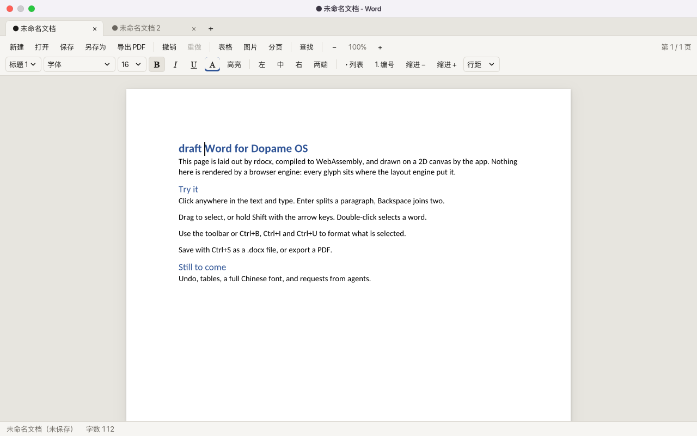
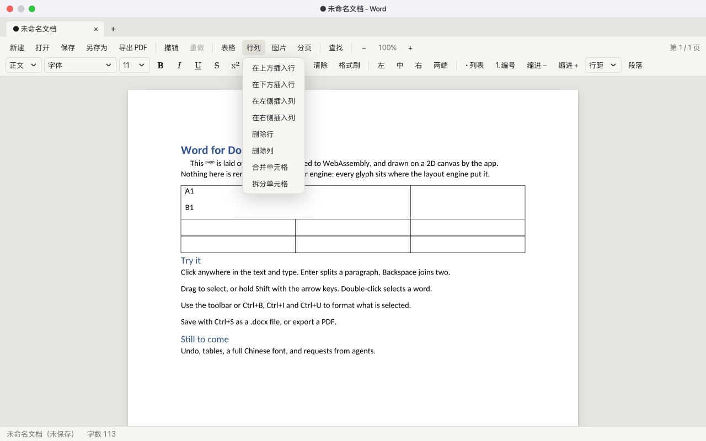

# HelloWord

给 Dopame OS 写的文字处理应用：打开、编辑、保存 `.docx`，导出 PDF。

页面由 [rdocx](https://github.com/tensorbee/rdocx) 排版引擎（Rust，编译成 WebAssembly）计算，再由应用自己画到 Canvas 上。Dopame 的运行时不是浏览器内核，没有现成的富文本编辑能力，所以光标、选区、输入法、撤销这些编辑功能都是这个项目自己实现的。



## 功能

| 类别 | 内容 |
|---|---|
| 文件 | 新建、打开和保存 docx、另存为、导出 PDF、多文档标签页、未保存提示 |
| 编辑 | 鼠标和键盘移动光标与选区、中文输入法、撤销重做、查找替换、复制剪切 |
| 字符格式 | 字体、字号、加粗、斜体、下划线、删除线、上标、下标、文字颜色、高亮、清除格式、格式刷 |
| 段落格式 | 对齐、标题 1 到 3、项目符号、编号、缩进、首行缩进、行距、段前段后间距、分页符 |
| 表格 | 插入、单元格内编辑、增删行列、合并和拆分单元格 |
| 图片 | 插入、选中、拖动换位置、拖角缩放、删除 |
| 视图 | 缩放、页码、字数统计 |
| 系统集成 | 系统菜单栏、双击 docx 文件打开、接受其他应用和智能体的请求 |



## 运行

需要先装好 Dopame 的开发工具 `acde`（见[官方文档](https://docs.dopame.ai)）和 [Bun](https://bun.sh)。

```sh
git clone https://github.com/wwyking123/HelloWord.git
cd HelloWord
bun install
acde dev
```

`acde dev` 会构建应用并在 Dopame 运行时里打开窗口，改代码后自动重载。要在 Dopame 桌面里运行：

```sh
acde dev --desktop dopame
```

排版引擎已经构建好放在 `src/wasm/` 里，克隆下来不需要 Rust 工具链。

## 测试

```sh
acde test
```

`e2e/` 下有 6 组端到端测试，共 27 个，覆盖编辑、格式、表格、图片、标签页和智能体请求。每个测试都在一个独立的无窗口会话里真实操作应用。

在装了中文输入法的 Linux 桌面上跑测试时，输入法会接管测试模拟的按键，需要先切到英文输入法。

## 结构

```
src/
  main.ts       界面、标签栏、多文档管理、文件读写、对话框、系统菜单
  editor.ts     光标、选区、输入、撤销重做、格式、表格和图片操作
  view.ts       页面视图：滚动的页面列，只给视野附近的页建画布
  render.ts     把一页的排版结果画到 Canvas 2D
  geometry.ts   页面坐标和文档位置的互相换算
  engine.ts     对 wasm 引擎的封装
  requests.ts   其他应用和智能体发来的请求
  fonts.ts      把引擎用的字体注册给 Canvas
  wasm/         构建好的排版引擎
e2e/            端到端测试
scripts/        重新构建引擎的脚本
```

一次编辑的流程：编辑器把修改交给引擎，引擎重新排版并给出每页上每段文字的位置，视图只重画内容有变化的页，编辑器再根据新的排版结果摆放光标和选区。

文档里的位置用“第几个段落 + 段内第几个字符”表示，正文段落和表格单元格里的段落统一编号。

## 给智能体用

Dopame 的智能体通过两种方式使用这个应用。

**读界面。** Canvas 上只有像素，所以每页上面叠了一层透明的文字层，标题、段落、图片都是真实的元素。智能体读界面语义树就能看到文档内容，也能按元素引用去点击。

**发请求。** 其他应用或智能体可以直接让 Word 做事：

```js
import { open } from 'acde:open'

await open('word', { kind: 'new-document', title: '周报', text: '# 本周进展\n完成了表格功能。' })
await open('word', { kind: 'insert-text', text: '下周计划……', at: 'end' })
```

| 请求 | 作用 |
|---|---|
| `new-document` | 在新标签里新建文档，可带标题和内容（`#`、`##`、`###` 开头的行是标题） |
| `insert-text` | 在光标处、文档开头或结尾插入文字 |
| `replace-text` | 替换文档里所有匹配的文字 |
| `save-document` | 保存文档 |
| `export-pdf` | 导出 PDF |

发请求的应用需要在自己的配置里声明 `"open": ["word"]`。请求没有返回值，结果显示在窗口底部的状态栏，智能体从那里读。

## 排版引擎

`src/wasm/` 里的引擎构建自 rdocx 的一个修改版。上游 rdocx 提供文档模型、排版和导出，但没有编辑器需要的接口，修改版加了这些：

- 按段落号和字符位置增删文字、拆分合并段落、设置格式
- 表格的行列增删和单元格合并拆分、图片的移动缩放删除
- 撤销和重做
- 把每页的排版结果连同文字在文档里的来源位置一起交给界面
- 让空列表项和只有图片的段落也有光标位置
- 内置完整的思源黑体，用于中文

修改版的源码目前不在这个仓库里。`scripts/build-wasm.sh` 是从修改版源码重新构建引擎用的，只改界面层不需要它。

## 已知限制

- 页眉、页脚、文本框能显示，不能编辑
- 图片只能是行内图片，没有文字环绕
- 表格不能调列宽和行高，不支持表格里再套表格
- 没有页面设置（纸张、页边距）、打印、修订和批注
- 复制粘贴只带纯文本

## 第三方内容

- [rdocx](https://github.com/tensorbee/rdocx)，MIT 许可证
- 思源黑体（Noto Sans SC），SIL Open Font License 1.1
